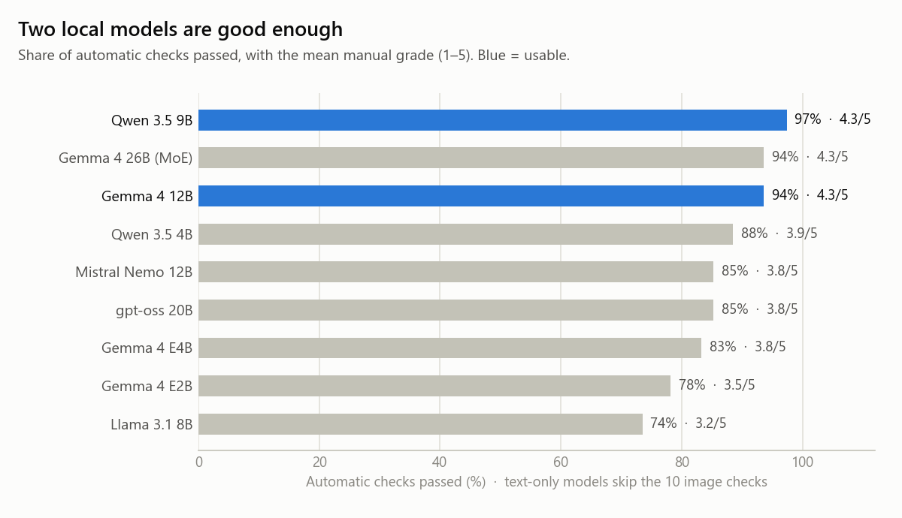
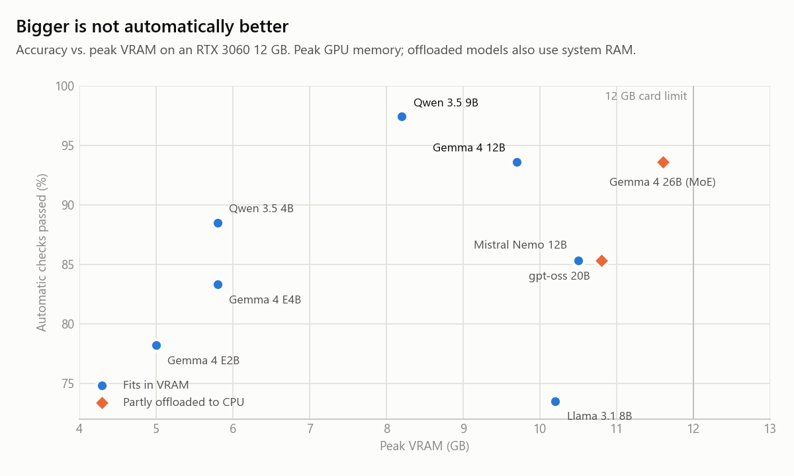
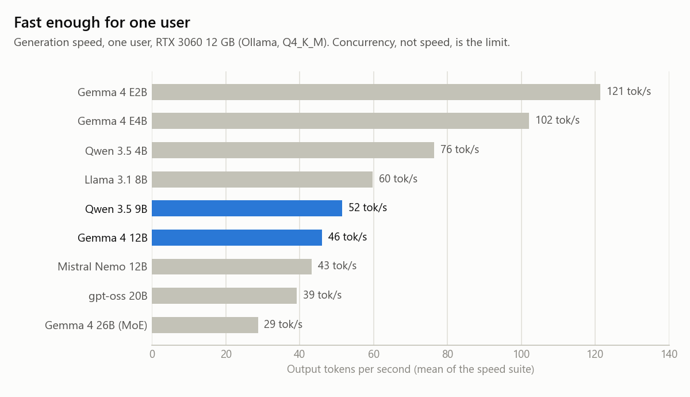

# openweight-benchmark

**Which open-weight LLM is good enough to run privately on modest hardware?**

I tested 10 open-weight models on one consumer GPU (RTX 3060, 12 GB) with 86 tests built around a
fictional company's real-looking documents: contracts, emails, a 30k-token operations manual,
scanned invoices, and tool calls, in Italian, English and Spanish. Each answer was checked
automatically and graded by hand on a 1–5 rubric.

**Short answer:** Qwen 3.5 9B (97% of automatic checks, 4.3 / 5) and Gemma 4 12B (94%, 4.3 / 5) are
good enough for a private document assistant on a 12 GB card. The 2024 generation (Llama 3.1 8B,
Mistral Nemo 12B) is not. Quality is not the bottleneck; concurrency is: with four simultaneous
users the first word arrives after about 17 seconds.

Results page: [`site/index.html`](site/index.html) · Failure modes: [`docs/failure-modes.md`](docs/failure-modes.md)

<picture>
  <source media="(prefers-color-scheme: dark)" srcset="docs/charts/quality-by-model-dark.png">
  
</picture>

## Method

**Corpus.** "Rossi Impianti" is an invented heating and cooling installer with an Italian head
office and a UK branch. [`corpus/facts.yaml`](corpus/facts.yaml) is the single source of truth:
12 documents (one is a 30k-token manual with 8 planted "needle" facts) and 5 images (a rotated,
noisy invoice scan, a filled-in form, a bar chart, a two-currency price table, a tilted rating
plate) are all derived from it, so every expected answer can be traced back to one line.

**Suite.** 86 tests in [`benchmark/`](benchmark/), across 10 capabilities (one YAML file each,
`01-speed.yaml` to `10-reasoning.yaml`). The test data (prompts, documents, expected values in the
checks, model outputs) stays in its original language. Test ids and the category names stored in
the raw result files keep their original Italian identifiers (e.g. `tool-pianifica-data`,
`03-documenti`); `scripts/evaluate.py` maps the old category names to the English ones.

| # | Capability | What it checks |
|---|---|---|
| 1 | Speed | tokens/s, time to first token, 10k and 30k-token prompts, 1 vs 4 users |
| 2 | Conversation | multi-turn memory, staying on topic, tone with an angry customer |
| 3 | Documents | Q&A and extraction from short and 30k-token documents |
| 4 | Summaries | faithfulness, required length, no invented content |
| 5 | Hallucination traps | missing facts, false premises, look-alike entities |
| 6 | Images | reading scans, forms, charts and tables (vision models only) |
| 7 | Writing | business emails, reports and proposals with formal constraints |
| 8 | Multilingual | answering in the question's language, translation, register |
| 9 | Tools and JSON | right function and arguments, schema-valid JSON, knowing when no tool is needed |
| 10 | Reasoning and code | multi-step arithmetic on rules, logic puzzles, small Python and SQL |

**Grading.**
- *Automatic checks* (78 tests; 68 for text-only models, which skip the image tests): substring,
  regex, language detection, JSON and tool-argument rules, in [`scripts/evaluate.py`](scripts/evaluate.py).
- *Manual grades* (41 tests per model) on a 1–5 rubric: 5 = perfect; 4 = correct with minor flaws;
  3 = usable after correction; 2 = substantive errors; 1 = unusable or invented. Each grade has a
  one-line justification in [`results/scores/`](results/scores/).

Manual quality scores were assigned by Claude (Anthropic) against a rubric I defined, and I reviewed every score, correcting it where needed.

**Setup.** Ollama 0.40.7, default Q4_K_M quantisation, temperature 0.2, one run per test,
thinking/reasoning off unless stated, 8k context (40k for long-document tests). Documents are put
in the prompt whole (no retrieval), so the test measures the model, not a RAG pipeline.

## Results

| Model | Automatic checks | Manual (1–5) | tok/s, 1 user | Peak VRAM | 1st token, 4 users |
|---|---|---|---|---|---|
| **Qwen 3.5 9B** | **97%** (76/78) | **4.3** | 52 | 8.2 GB | 16.8 s |
| **Gemma 4 12B** | **94%** (73/78) | **4.3** | 46 | 9.7 GB | 18.1 s |
| Gemma 4 26B (MoE)\* | 94% (73/78) | 4.3 | 29 | 11.6 GB | 34.3 s |
| Qwen 3.5 4B | 88% (69/78) | 3.9 | 76 | 5.8 GB | 9.9 s |
| gpt-oss 20B\* | 85% (58/68) | 3.8 | 39 | 10.8 GB | 23.9 s |
| Mistral Nemo 12B | 85% (58/68) | 3.8 | 43 | 10.5 GB | 16.2 s |
| Gemma 4 E4B | 83% (65/78) | 3.8 | 102 | 5.8 GB | 10.1 s |
| Gemma 4 E2B | 78% (61/78) | 3.5 | 121 | 5.0 GB | 6.6 s |
| Llama 3.1 8B | 74% (50/68) | 3.2 | 60 | 10.2 GB | 12.1 s |

\* Did not fit in 12 GB; ran partly on the CPU. A tenth run (`gemma4:latest`) turned out to use a
stale six-month-old build without vision and is excluded from the ranking; it remains in the raw
results. Per-capability numbers: [`results/SUMMARY.md`](results/SUMMARY.md).

<picture>
  <source media="(prefers-color-scheme: dark)" srcset="docs/charts/quality-vs-vram-dark.png">
  
</picture>

<picture>
  <source media="(prefers-color-scheme: dark)" srcset="docs/charts/speed-by-model-dark.png">
  
</picture>

### Key findings

1. **Two models are usable today.** Qwen 3.5 9B is the most reliable on documents, hallucination
   traps, JSON and images. Gemma 4 12B writes better but often answers in the wrong language.
2. **Small models read scans well.** Qwen 3.5 9B, Gemma 4 12B and Qwen 3.5 4B passed all 10 image
   checks. Gemma 4 E2B could not read images at all.
3. **No model is ready for customer service without guardrails.** Seven of ten promised engineers
   "within the hour", refunds or replacement equipment that nobody had authorised.
4. **Local "thinking" mode is not worth it.** With reasoning on, Qwen 3.5 9B dropped from 43/44 to
   31/44 correct and went from 4.9 s to 30.5 s per answer; Gemma 4 12B dropped from 40/44 to 38/44.
5. **Mixture-of-experts survives CPU offload.** Gemma 4 26B (3.8B active parameters) kept
   29–36 tok/s half on the CPU, while dense Mistral Nemo fell to 1.7 tok/s at 30k tokens of context.
6. **Dates, arithmetic and permissions belong outside the model.** Most failures are fixed by the
   system around the model (absolute dates, tools, an explicit list of allowed actions), not by a
   bigger model.

## Failure modes

Pass rates hide *how* models fail. [`docs/failure-modes.md`](docs/failure-modes.md) has six real
examples copied from the stored outputs, each with the expected answer and why it matters:

- gpt-oss 20B inventing a ticket number, a technician, an app, a URL and a phone number one digit off the real one;
- the best model promising a one-hour dispatch and a full refund to an angry customer;
- a model saying a booking "has been scheduled" without calling the booking tool;
- correct answers in the wrong language;
- a one-day training session summarised as five days;
- multi-step leave arithmetic giving 7 days instead of 21.

Writing them up also exposed two bugs in my own evaluation: a test premise that says "Monday
20 October 2026" (it is a Tuesday), and a substring check that passed an Italian answer because
*telefo**no*** contains `"no "`. Both are documented rather than silently fixed.

## How to run

Requirements: Python 3.10+, [Ollama](https://ollama.com) with the models pulled, an NVIDIA GPU
(the speed figures above are for 12 GB). Commands use Windows paths for the virtual environment;
on Linux or macOS use `.venv/bin/python`.

```bash
python -m venv .venv
.venv/Scripts/pip install openai pyyaml httpx matplotlib

# full suite on one model (results go to results/local/<model>/)
.venv/Scripts/python scripts/run.py --model qwen3.5:9b --suite all
# speed tests with 4 simultaneous users
.venv/Scripts/python scripts/run.py --model qwen3.5:9b --suite benchmark/01-speed.yaml --users 4

.venv/Scripts/python scripts/evaluate.py results/local/qwen3.5_9b   # automatic checks + review sheet
.venv/Scripts/python scripts/report.py                              # results/SUMMARY.md
.venv/Scripts/python scripts/make_charts.py                         # docs/charts/ and site/ data
```

Options: `--skip-vision` for text-only models, `--think` to enable reasoning, `--think-level low`
for gpt-oss, `--backend openai --base-url ...` for an OpenAI-compatible server such as vLLM.
Close other GPU-heavy applications first: the runner records VRAM in use before each run.
`python scripts/build_corpus.py` regenerates the long manual and the images (fixed seed).

The results page in [`site/`](site/) is plain HTML with no build step. Serve the repository root
(for example `python -m http.server`) and open `/site/`; on GitHub Pages, publish from the
repository root so the page's links to `results/` and `docs/` resolve.

## Repository layout

| Path | Contents |
|---|---|
| `benchmark/` | The 86 tests (YAML): prompts, expected answers, automatic checks |
| `corpus/` | Fictional company documents, images and `facts.yaml` (ground truth) |
| `scripts/` | Runner, evaluator, report and chart generator |
| `results/local/` | Raw outputs per model: responses, timings, VRAM (`*.json`), check results (`*.eval.json`), review sheets |
| `results/scores/` | Manual 1–5 grades with a one-line note per test |
| `docs/` | Failure modes, charts, full conclusions ([`conclusions-track-a.md`](docs/conclusions-track-a.md)), test plan, model research and hardware notes |
| `site/` | Static results page |

## Limitations

- **One run per test** at temperature 0.2. The same prompt can pass on one run and fail on the next (see failure mode 5).
- **One machine and one quantisation** (Q4_K_M on an RTX 3060 12 GB, Ollama). Other cards, runtimes or Q8 weights may rank differently. Ollama serves parallel requests in a queue, so the 4-user figures describe this setup, not the models.
- **Manual grades come from an LLM grader** using my rubric, not from a panel of human raters.
- **Automatic checks are string rules.** They can pass a wrong answer and fail a right one phrased differently.
- **Small, synthetic corpus.** One fictional company and 86 tests are enough to separate these models, not to make statistically strong claims.
- **Corpus revised after the runs.** Results were measured on a previous revision of the corpus. The later edits were limited to anonymising place names: two UK addresses (a real business park and street name with real-looking Leicester postcodes) became "Example" addresses without a postcode, and a real hospital named in the smoke test became a fictional one. The same substitution was applied to the stored outputs that quoted those strings (four reasoning traces and four smoke-test answers). No test checks an address or the hospital name, so no automatic result or grade changed.
- **Known test bug.** `tool-pianifica-data` states a weekday that does not match the date, and a few weekdays in the corpus are wrong in the same way. The stored results are unchanged; the test will be fixed before the next run.
- **Not yet tested:** larger models (27B–120B) on rented GPUs, and concurrency with vLLM. Planned, not done.

## License

Released under the [MIT License](LICENSE).
